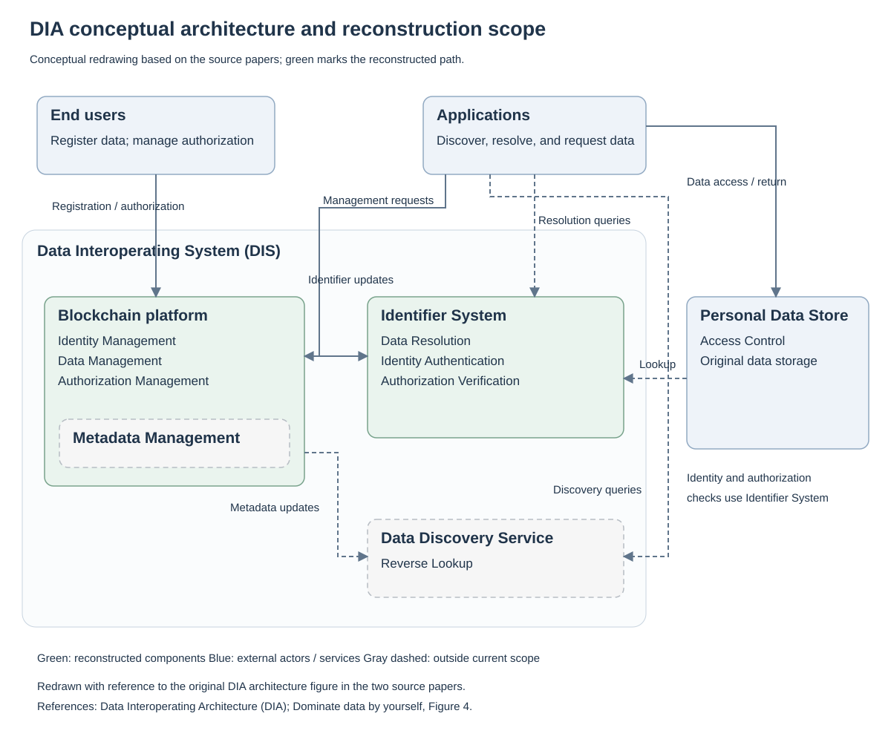
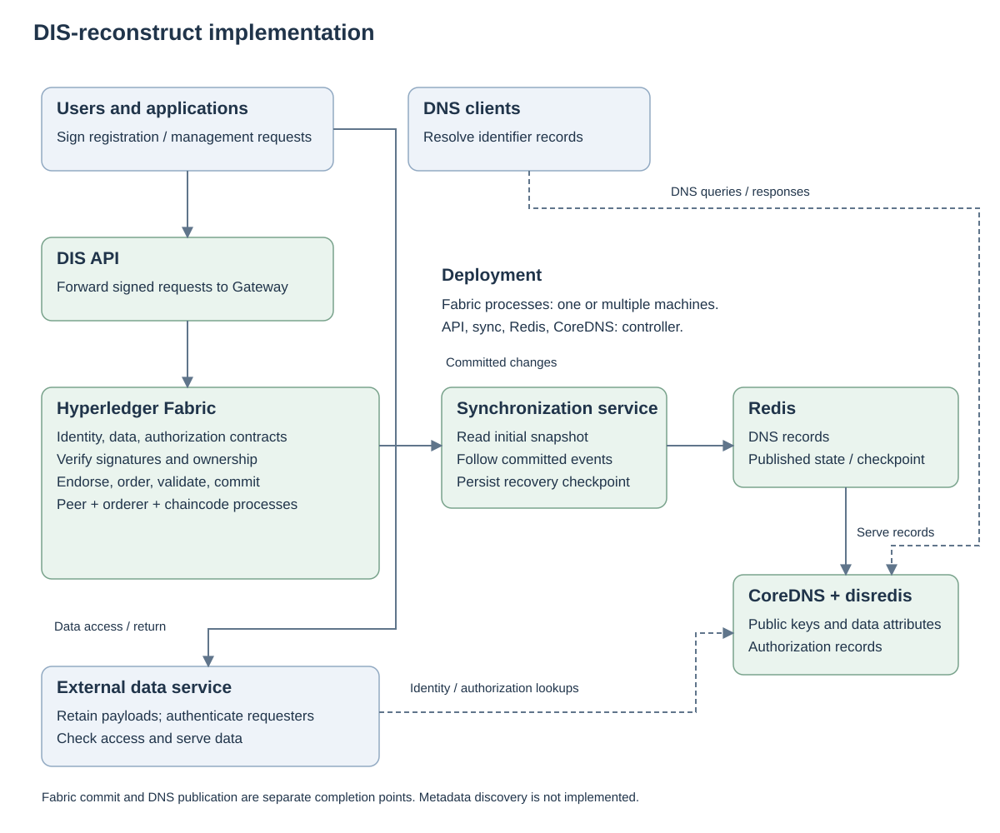

# DIS-reconstruct

This project reconstructs the DNS identifier registration, management, authorization, and resolution components described in Figure 1 of [Data Interoperating Architecture (DIA): Decoupling Data and Applications to Give Back Your Data Ownership](https://ieeexplore.ieee.org/document/10197025) and [Dominate data by yourself: a decentralized scheme for data interoperation when data is decoupled from applications](https://link.springer.com/article/10.1007/s11280-025-01337-z), following the papers and their source code.

## System design

### Source architecture and reconstruction scope

The two source papers describe Data Interoperating Architecture (DIA), in which the Data Interoperating System (DIS) connects blockchain-based management, an identifier system, and a data discovery service. End users manage their data and authorizations; applications use these services to locate and access data held in personal data stores.

**Figure attribution:** This schematic is redrawn with reference to the original DIA architecture figure in Figure 1 of [Data Interoperating Architecture (DIA): Decoupling Data and Applications to Give Back Your Data Ownership](https://ieeexplore.ieee.org/document/10197025) and Figure 4 of [Dominate data by yourself: a decentralized scheme for data interoperation when data is decoupled from applications](https://link.springer.com/article/10.1007/s11280-025-01337-z). The layout is simplified, and colors identify the components covered by this reconstruction.

DIS-reconstruct implements the identity, data, and authorization management components and their connection to identifier resolution, highlighted in green. Metadata discovery and reverse lookup are outside the current reconstruction. Personal data storage and access control remain external services.

### Reconstructed implementation

| Source component | Implementation in this repository |
|---|---|
| Identity Management | Fabric contracts register user and application identifiers with public keys and verify signed management requests. |
| Data Management | Fabric contracts register data identifiers and update their owner, address, and submitted data signature. Registration profiles are stored as metadata. |
| Authorization Management | Fabric contracts record application requests, owner decisions, and changes to authorization status, permissions, recipients, and expiration. |
| Update Identifier | The synchronization service initializes from a committed snapshot and applies committed Fabric events to Redis with a recovery checkpoint. |
| Identifier System | CoreDNS with the disredis plugin returns public keys, data attributes, and authorization records that consumers use for resolution, authentication, and authorization checks. |

Users and applications sign management requests and submit them through the DIS API. Fabric contracts check signatures, ownership, and operation conditions; Fabric validates endorsements and commits transactions. The synchronization service publishes the resulting records to Redis, and CoreDNS answers identifier queries. A successful ledger commit and a DNS-visible update are separate completion points.

External data services retain the original payloads and perform requester authentication and access control using the relevant records. The reconstruction publishes these records; it does not implement the external data service.

Fabric peer, orderer, and chaincode processes can run on one or multiple machines. The API, synchronization service, Redis, and CoreDNS currently run on the controller. See the [experiment deployment guide](docs/experiment-deployment.md) for configurable organization counts and node placement.

## Install and build

Use a Linux amd64 machine with Git, Go 1.23.4 or later, Python 3.9 or later with venv support, a C compiler, and make. Multi-machine deployment also requires rsync and noninteractive SSH access from the controller to workers.

~~~bash
git clone https://github.com/han-ry19/DIS-reconstruct.git
cd DIS-reconstruct
python3 -m venv .venv
. .venv/bin/activate
python -m pip install PyYAML
python scripts/bootstrap.py
go build -o bin/ ./cmd/...
~~~

The bootstrap script installs Fabric 2.4.9, CoreDNS 1.12.0 release assets, and Redis 7.2.5 under runtime/tools. The Go build creates the application commands and CoreDNS with the project's Redis plugin. See the [running guide](docs/runbook.md) for offline installation and verification options.

## Run on one machine

The repository-root [config.yaml](config.yaml) selects the runtime directory, network topology, Gateway concurrency, and service ports. After building, run:

~~~bash
./run.sh plan     # Validate and print the configuration without starting processes
./run.sh          # Start the configured deployment
./run.sh status   # Inspect managed processes
./run.sh down     # Stop the deployment and retain its data
~~~

The default configuration starts four organizations with one peer each, four Raft orderers, and a business endorsement threshold of three organizations. All components run on the same machine. Startup prints the configuration path, runtime directory, node endpoints, endorsement policy, Gateway concurrency, service listeners, and log directories. It reports DIS is ready after the readiness checks pass. Processes continue in the background after the launcher exits.

| Service | Default endpoint |
|---|---|
| HTTP API | 127.0.0.1:38080 |
| Authoritative DNS | 127.0.0.1:38530, UDP and TCP |
| Redis | 127.0.0.1:38679 |

Run the signed registration and authorization example and verify DNS publication:

~~~bash
bin/dis-demo -url http://127.0.0.1:38080
bin/dis-sync -fabric-config runtime/configured/fabric/gateway.json \
  -redis 127.0.0.1:38679 -check -verify 127.0.0.1:38530
~~~

Certificates, ledger data, publication state, and logs are retained under runtime/configured. Logs are in its fabric/ and services/ subdirectories. Re-running ./run.sh reuses this deployment.

## Run across multiple machines

Peer nodes, Raft orderers, and their associated chaincode processes can run on different machines. The API, event publisher, Redis, and CoreDNS run on the controller. The controller transfers node binaries, certificates, and configuration over SSH and manages the remote processes.

Each worker needs Linux amd64, Python 3, rsync, and a writable dedicated runtime directory. The controller must have noninteractive SSH access to workers. Advertised peer and orderer addresses and their assigned ports must be reachable by the controller and other nodes.

Save the following as config/two-host.yaml, replacing the example addresses, SSH account, and worker directory with your own:

~~~yaml
version: 1
runtime: ../runtime/two-host

network:
  organizations: 3
  peers_per_organization: 1
  orderers: 3
  endorsement_threshold: 2
  gateway_concurrency: 500
  port_base: 21000
  domain: dis-local
  hosts:
    controller:
      address: controller.example.org
    worker:
      address: worker.example.org
      ssh: experiment@worker.example.org
      root: /home/experiment/dis-runs/two-host
  placement:
    peers: [controller, worker, worker]
    orderers: [controller, worker, controller]

services:
  api_port: 45080
  dns_port: 45530
  redis_port: 45679
~~~

This example distributes three organizations' peers and three Raft orderers over two machines, with two-organization business endorsement. Placement lists assign each peer and orderer to a host; they describe process placement rather than one organization per physical machine.

Run every command on the controller with the same configuration file:

~~~bash
./run.sh plan --config config/two-host.yaml
./run.sh up --config config/two-host.yaml
./run.sh status --config config/two-host.yaml
./run.sh down --config config/two-host.yaml
~~~

Relative runtime paths resolve against the configuration file's directory. The example therefore uses ../runtime/two-host. Use a new runtime directory and available ports when changing topology; editing YAML does not change membership in an existing channel. Peer and orderer ports are derived from port_base and printed by plan. See the [configuration guide](config/README.md) and [experiment deployment guide](docs/experiment-deployment.md) for field definitions and port allocation.

The API, DNS, and Redis listeners currently bind to the controller's loopback interface. Applications running on the controller can use them directly. Remote API clients can use an SSH local-forwarding tunnel; remote DNS access requires an appropriate tunnel or an explicit listener configuration change. Multi-machine node deployment does not expose these services automatically. Remote node logs are stored under the worker's configured runtime directory.

## Documentation

- [Data and authorization management](docs/management-updates.md)
- [Architecture](docs/architecture.md)
- [Mapping to Data Interoperating Architecture (DIA): Decoupling Data and Applications to Give Back Your Data Ownership and Dominate data by yourself: a decentralized scheme for data interoperation when data is decoupled from applications](docs/dia-mapping.md)
- [Implementation decisions](docs/decisions.md)
- [Running guide](docs/runbook.md)
- [System verification](docs/verification.md)
- [Experiment deployment](docs/experiment-deployment.md)
- [Original implementation mapping](docs/original-implementation.md)
