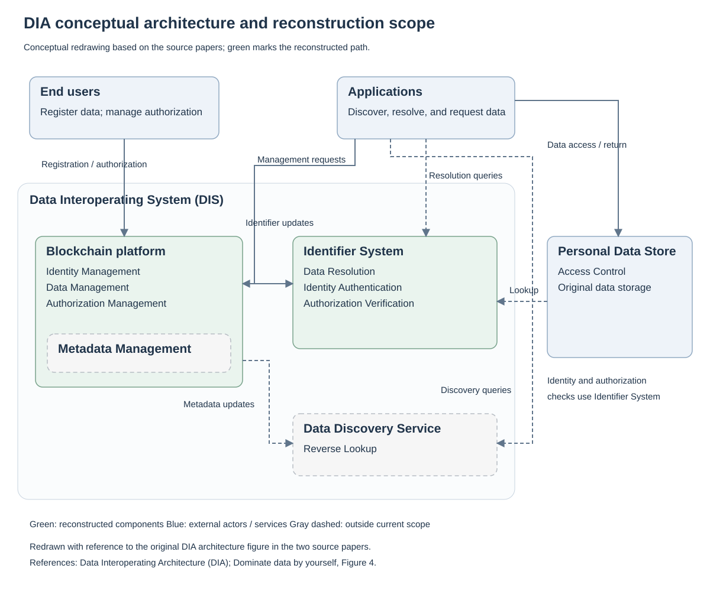
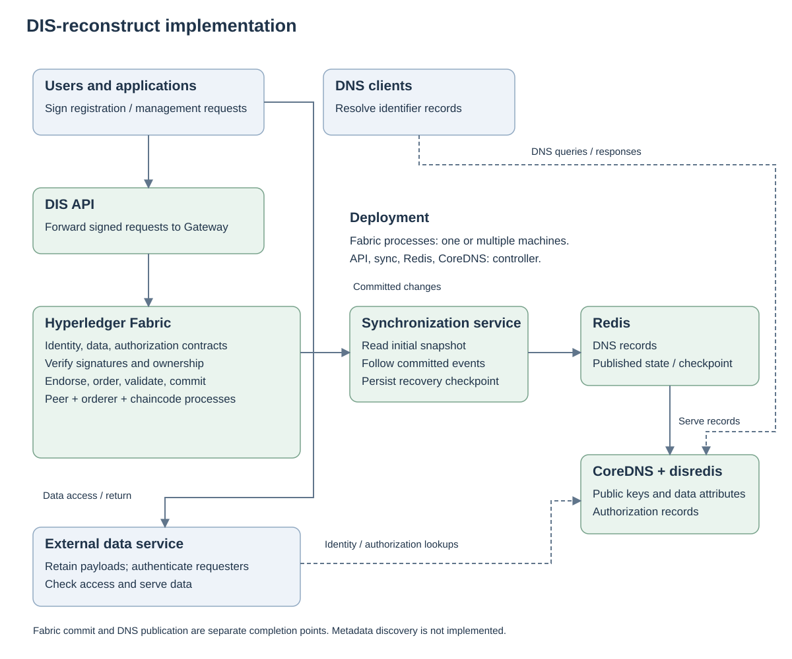

# Architecture

DIS-reconstruct implements the identity, data, and authorization management path of the source architecture and connects it to DNS resolution. See the [source mapping](dia-mapping.md) for paper references.

## Components and workflow

Users and applications sign management requests and submit them to the DIS API. The API forwards requests through Fabric Gateway. Contracts verify signatures, current ownership, and operation parameters. Fabric collects endorsements, orders transactions through Raft, and validates and commits them.

| Component | Responsibility | Code |
|---|---|---|
| API | Submit signed requests and query business records | internal/api, cmd/dis-api |
| Business rules | Identity registration, data updates, authorization requests and decisions | internal/domain |
| Fabric adapter | Gateway submission, queries, and event subscription | internal/fabric |
| Contracts | Load affected records, apply rules, persist changes, emit events | chaincode/dis |
| Publisher | Apply committed events and maintain a recoverable DNS projection | cmd/dis-sync, internal/dns |
| DNS server | Answer identifier queries from Redis records | cmd/dis-coredns, plugin/disredis |

## Ledger organization

Composite keys separate identities, data objects, pending authorizations, and request receipts. Data objects embed decided authorizations. Auxiliary records maintain identifier/index mappings, owner and recipient associations, registration profiles, and transaction information.

Ordinary updates load affected business objects and the actor's request receipt. Fresh ledgers use transaction IDs and actor-scoped receipts to identify successful operations. Snapshots derive the publication sequence from committed receipts, allowing independent registrations to avoid a shared counter write.

## Publication and resolution

The publisher initializes from a committed snapshot and follows chaincode events. Redis transactions update DNS records, cached business objects, and the event checkpoint together. Reconnection resumes at the saved block and transaction. Already applied events are skipped; sequence-based legacy ledgers recover detected event gaps through a snapshot.

CoreDNS queries Redis by zone and relative name. Identity records expose public keys; data records expose ownership, address, and signature attributes; authorization records expose status, permissions, and expiration. External data services use these records when authenticating requesters and enforcing access.

A successful API write confirms a valid Fabric commit. DNS publication completes when the corresponding authoritative records are available. Zone-file exports support inspection; the running DNS server reads Redis.

## Deployment

Fabric peers, orderers, and colocated chaincode processes can be placed across machines. The API, publisher, Redis, and CoreDNS run on the controller. [config.yaml](../config.yaml) and [run.sh](../run.sh) provide the deployment entry point. See [configuration](../config/README.md) and [multi-machine deployment](experiment-deployment.md).
