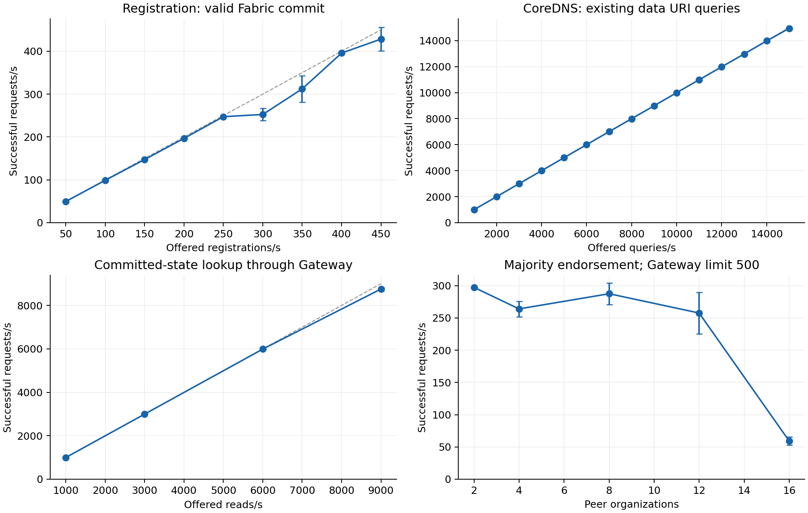
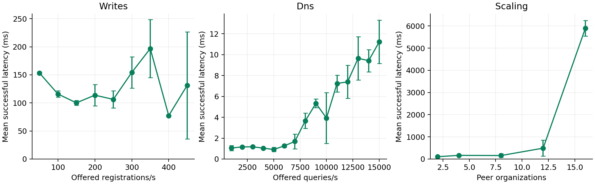

# Registration and DNS benchmark measurements, 2026-10-30

The reconstructed registration and DNS components were measured on a remote Linux server using real Fabric commits and authoritative CoreDNS responses. The experiment follows the offered-load and node-scaling questions in the two reference papers. Tables below separate the published measurements from this implementation.

## Reference experiments

| Paper | Registration at 300 offered TPS | DNS reference |
|---|---|---|
| Data Interoperating Architecture (DIA): Decoupling Data and Applications to Give Back Your Data Ownership | 179.2 TPS; 8.62 s mean latency | 8,947.6 QPS at 9,000 offered QPS; success above 99%; latency below 4 ms |
| Dominate data by yourself: a decentralized scheme for data interoperation when data is decoupled from applications | 190.6 TPS; 6.82 s mean latency | 8,947.6 QPS at 9,000 offered QPS; success above 99%; latency below 4 ms |

References: COMPSAC 2023, DOI 10.1109/COMPSAC57700.2023.00065, experimental evaluation; World Wide Web 2025, DOI 10.1007/s11280-025-01337-z, Section 8. The papers use four 16-vCPU, 32-GB servers and a separate client, with Caliper for writes and dnsperf for DNS. Their scale studies include fixed-orderer peer scaling; the second paper also varies committee size.

## Measurement contract

- Fabric 2.4.9, CoreDNS 1.12.0 with the disredis plugin, Redis 7.2.5, and dnsperf 2.9.0. Fabric uses five Raft orderers, a 500-ms block timeout, and a 10-transaction block limit.
- Load sweeps use five peer organizations, one peer per organization, and three-organization endorsement. Scale runs use 2, 4, 8, 12, and 16 organizations, one peer per organization, five orderers, and floor(N/2)+1 endorsement.
- The server has 128 logical CPUs (Intel Xeon Gold 6338 at 2.00 GHz). Clients and server processes share this physical machine; CPU quotas are not applied. A separate four-organization deployment remains idle.
- Registration submits signed data.register operations with distinct data identifiers and a common owner within each run. Owner setup, request signing, and full-state checks are outside the timed window. No automatic retry is used. The benchmark calls the Go Fabric Gateway client directly.
- A successful write means the Gateway returned a valid Fabric commit. Throughput is successful calls divided by scheduling plus drain time. Latency covers each Gateway call through valid-commit return. DNS visibility latency is a separate completion condition and is not measured by this write latency.
- DNS queries request URI records for 1,000 existing data identifiers. The projection is verified before the DNS sweep. Success means a NOERROR response; loss and other response codes count against success. dnsperf uses 16 clients, four threads, and a two-second query timeout.
- Chain reads invoke GetData through the Gateway. They measure committed-state reads, rather than consensus submissions.
- Each sweep point schedules load for five seconds and is repeated three times. Sweep order is deterministically shuffled. Scale sizes run in ascending order. Values are arithmetic means across runs; ± is sample standard deviation. Longer confirmation runs use 30 seconds and three repetitions.
- Fresh ledgers store independent object records and retry receipts. Publication serials are derived from receipts, avoiding a shared write counter between independent registrations. Existing sequence-based deployments retain their format. This is the measured reconstruction guided by the papers and source code.

The hardware, software versions, client placement, load generator, and explicit workload above define these measurements. Published values provide context; speedup ratios against those values are not computed.





Figures show five-second sweeps with three repetitions. Error bars denote sample standard deviation; dashed lines show offered load. The scale panel uses five Raft orderers and a Gateway concurrency limit of 500.

## Registration load sweep

| Offered registrations/s | Successful throughput (requests/s) | Mean latency (ms) | Success (%) |
|---:|---:|---:|---:|
| 50 | 49.55 ± 0.21 | 153.25 ± 2.27 | 100.0000 |
| 100 | 98.91 ± 0.22 | 115.81 ± 5.58 | 100.0000 |
| 150 | 147.40 ± 2.29 | 100.11 ± 4.30 | 100.0000 |
| 200 | 196.70 ± 1.98 | 113.79 ± 18.93 | 100.0000 |
| 250 | 247.32 ± 0.36 | 106.27 ± 15.03 | 100.0000 |
| 300 | 252.49 ± 14.03 | 154.30 ± 28.03 | 100.0000 |
| 350 | 312.10 ± 30.74 | 196.78 ± 51.54 | 100.0000 |
| 400 | 395.65 ± 0.29 | 77.32 ± 1.57 | 100.0000 |
| 450 | 428.32 ± 27.63 | 131.29 ± 95.34 | 100.0000 |

## Authoritative DNS load sweep

| Offered queries/s | Successful throughput (requests/s) | Mean latency (ms) | Success (%) |
|---:|---:|---:|---:|
| 1000 | 999.94 ± 0.01 | 1.06 ± 0.25 | 100.0000 |
| 2000 | 1999.91 ± 0.04 | 1.16 ± 0.05 | 100.0000 |
| 3000 | 2999.83 ± 0.00 | 1.17 ± 0.01 | 100.0000 |
| 4000 | 3998.72 ± 1.80 | 1.05 ± 0.05 | 100.0000 |
| 5000 | 4999.45 ± 0.41 | 0.91 ± 0.20 | 100.0000 |
| 6000 | 5999.66 ± 0.05 | 1.26 ± 0.14 | 100.0000 |
| 7000 | 6999.08 ± 1.08 | 1.69 ± 0.70 | 100.0000 |
| 8000 | 7996.79 ± 4.74 | 3.67 ± 0.74 | 100.0000 |
| 9000 | 8990.73 ± 9.41 | 5.34 ± 0.41 | 100.0000 |
| 10000 | 9996.34 ± 5.07 | 3.92 ± 2.43 | 100.0000 |
| 11000 | 10990.20 ± 8.92 | 7.24 ± 0.81 | 100.0000 |
| 12000 | 11985.05 ± 12.94 | 7.39 ± 1.59 | 100.0000 |
| 13000 | 12973.75 ± 22.19 | 9.65 ± 2.09 | 99.9359 |
| 14000 | 13978.82 ± 19.50 | 9.42 ± 1.07 | 99.9629 |
| 15000 | 14946.17 ± 7.98 | 11.22 ± 2.07 | 99.9182 |

## Committed-state read sweep

| Offered reads/s | Successful throughput (requests/s) | Mean latency (ms) | Success (%) |
|---:|---:|---:|---:|
| 1000 | 998.86 ± 0.21 | 6.15 ± 0.03 | 100.0000 |
| 3000 | 2996.18 ± 0.51 | 7.88 ± 0.26 | 100.0000 |
| 6000 | 5990.12 ± 1.20 | 14.23 ± 0.71 | 100.0000 |
| 9000 | 8754.80 ± 72.05 | 35.90 ± 2.95 | 97.8481 |

## Organization scaling

| Peer organizations | Successful throughput (requests/s) | Mean latency (ms) | Success (%) |
|---:|---:|---:|---:|
| 2 | 297.41 ± 0.22 | 105.86 ± 29.91 | 100.0000 |
| 4 | 264.03 ± 11.98 | 165.58 ± 40.33 | 100.0000 |
| 8 | 287.55 ± 16.45 | 157.40 ± 80.34 | 100.0000 |
| 12 | 257.65 ± 32.06 | 491.15 ± 357.82 | 98.6222 |
| 16 | 59.24 ± 6.28 | 5894.32 ± 349.83 | 34.5778 |

All scale runs offer 300 registrations/s. Increasing organization count increases the majority endorsement requirement while preserving the five-orderer Raft group. Failed and ambiguous client completions remain in the denominator; a failed response does not prove that the transaction was absent from the ledger. Run summaries include before/after state counts and raw request errors.

## Longer registration confirmation

| Offered registrations/s | Successful throughput (requests/s) | Mean latency (ms) | Success (%) |
|---:|---:|---:|---:|
| 300 | 175.46 ± 103.34 | 196.55 ± 45.47 | 99.4481 |

Throughput above includes final request drain. The corresponding mean valid completions during the 30-second scheduling windows are 299.20, 298.87, 294.90 requests/s. Timeout responses extend the drain interval; per-run summaries retain both rates.

## Longer DNS confirmation

| Offered queries/s | Successful throughput (requests/s) | Mean latency (ms) | Success (%) |
|---:|---:|---:|---:|
| 9000 | 8998.00 ± 0.83 | 6.11 ± 0.14 | 100.0000 |

## Error interpretation

At 9,000 offered chain reads/s, the Gateway rejects requests after its configured 500-concurrent-request limit is reached. These are recorded as request errors. The read sweep retains both successes and errors. The same concurrency-limit error occurs in the 12- and 16-organization runs. These measurements describe the deployed Gateway configuration, rather than an inherent Raft or consensus capacity bound. Longer registration runs also record DeadlineExceeded responses; all such calls remain failures in the client completion metric. Error strings and counts are exported in error-counts.json.

## Artifacts and reproduction

summary.csv contains aggregate values; runs.json contains every run summary; error-counts.json preserves error categories; raw-manifest.json records hashes and sizes for the full raw logs retained under runtime/benchmarks/paper-20261030. environment.json records the source base revision, host description, and topology. Source changes during measurement are retained in the raw environment files. The source commit containing this report records the measured implementation.

The interrupted DNS readiness trial is retained separately as dns-interrupted-readiness with INVALID.txt and is excluded from these aggregates. The early shared-counter diagnostic is retained under runtime/benchmarks/pilot. Valid sweeps and error samples are all included.

Build the commands following docs/runbook.md. Deploy the measured topology and run workloads sequentially:

```bash
export DIS_RUNTIME="$PWD/runtime/experiments/paper"
python3 scripts/network.py up --topology deploy/topologies/paper-5org.yaml
python3 scripts/services.py up --api-port 48080 --dns-port 48530 --redis-port 48679
python3 scripts/benchmark-paper.py --kind writes --rates 50,100,150,200,250,300,350,400,450 --duration 5 --repetitions 3 --out runtime/benchmarks/new/writes
# Create a dnsperf input file containing existing-data-id.data. URI, one query per line.
# Restart publication to load and verify the completed registration dataset before read-only DNS trials.
python3 scripts/services.py down
python3 scripts/services.py up
python3 scripts/benchmark-paper.py --kind dns --rates 1000,2000,3000,4000,5000,6000,7000,8000,9000,10000,11000,12000,13000,14000,15000 --duration 5 --repetitions 3 --dns-queries queries.txt --out runtime/benchmarks/new/dns
python3 scripts/benchmark-paper.py --kind reads --rates 1000,3000,6000,9000 --duration 5 --repetitions 3 --out runtime/benchmarks/new/reads
python3 scripts/benchmark-scale.py --counts 2,4,8,12,16 --out runtime/benchmarks/new/scaling
python3 scripts/benchmark-paper.py --kind writes --rates 300 --duration 30 --repetitions 3 --out runtime/benchmarks/new/writes-confirmation
python3 scripts/services.py down
python3 scripts/services.py up
python3 scripts/benchmark-paper.py --kind dns --rates 9000 --duration 30 --repetitions 3 --dns-queries queries.txt --out runtime/benchmarks/new/dns-confirmation
python3 scripts/summarize-benchmarks.py --input runtime/benchmarks/new --output results/new --plots
```

Plot generation requires matplotlib. Run performance workloads sequentially. Keep the per-run JSONL request logs, dnsperf output, source diff, and one-second CPU/RSS samples for subsequent analysis.
